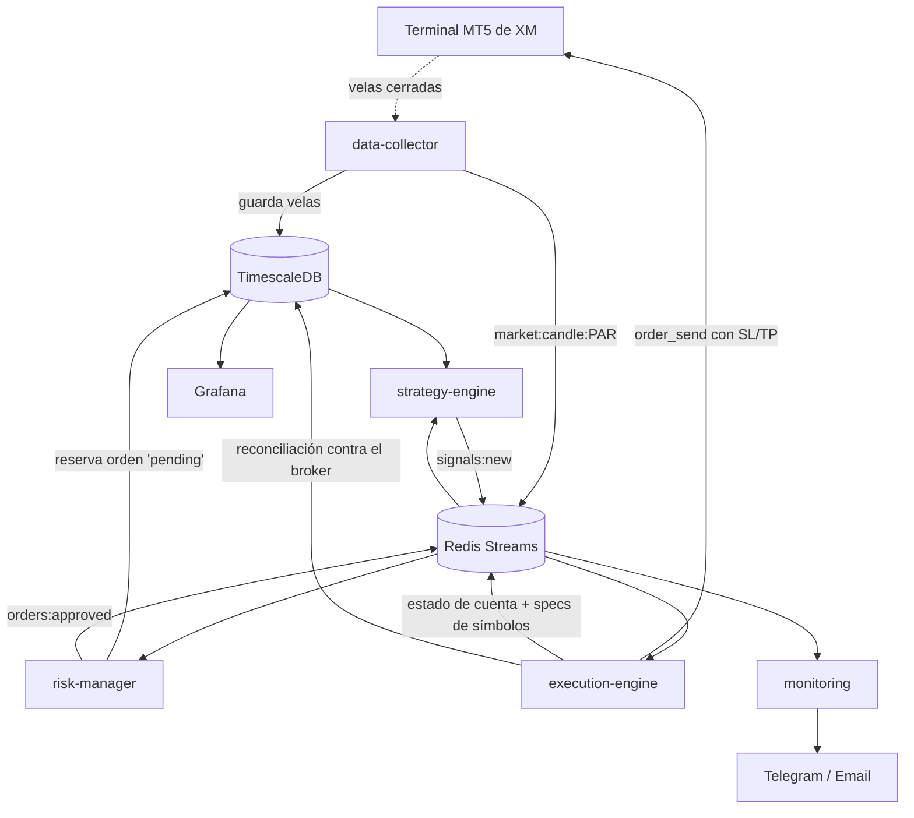

# 🚀 Sistema Profesional de Trading Forex Algorítmico

Plataforma modular de **trading algorítmico para Forex** con **arquitectura orientada a eventos y microservicios**. Python 3.12+, **OANDA API / MetaTrader 5**, TimescaleDB, Redis Streams, Grafana y Telegram.

---

## 🤖 Modelo predictivo: pipeline en un solo comando

Modelo LightGBM para EUR_USD H1, con datos de **Dukascopy** (gratis, sin cuenta). Se valida fuera de muestra con costos reales y corre en **paper trading** sin Docker ni broker.

### Instalación (Windows, PowerShell)
```powershell
python -m venv .venv
.venv\Scripts\pip install -r requirements-local.txt
```

### Uso
```powershell
.venv\Scripts\python pipeline.py                      # todo: datos -> validar -> entrenar -> señales
.venv\Scripts\python pipeline.py datos                # descarga/actualiza velas en data/ (parquet)
.venv\Scripts\python pipeline.py validar              # walk-forward + informe en reports/
.venv\Scripts\python pipeline.py entrenar             # modelo final con toda la historia -> models/
.venv\Scripts\python pipeline.py senales              # paper trading: procesa velas nuevas y termina
.venv\Scripts\python pipeline.py senales --continuo   # paper trading: revisa cada minuto (Ctrl+C para parar)
```
La primera vez descarga 6 años de datos (unos 30 s). El pipeline completo tarda menos de un minuto.

### Configuración: `config.yaml`
Par, temporalidad, costos (spread, slippage, comisión), riesgo (% por operación, SL y TP en ATR, pérdida diaria máxima), parámetros del modelo (horizonte, umbral de probabilidad, LightGBM) y ventanas de validación. **Sin claves**: las claves van en `.env`. Fija los valores **antes** de mirar los resultados; si los cambias hasta que el backtest salga bien, el resultado deja de ser fuera de muestra.

### Cómo funciona
| Pieza | Archivo | Qué hace |
|---|---|---|
| Datos | `backtesting/src/data_loader.py` | Dukascopy bid/ask → precio medio, spread real, solo velas cerradas, caché incremental |
| Features | `services/strategy-engine/src/ml/features.py` | Retornos, ATR, RSI, distancia a EMAs, volatilidad, hora y día. Solo usan el pasado |
| Target | `services/strategy-engine/src/ml/labels.py` | Triple barrera: ¿toca el TP (3 ATR) antes que el SL (2 ATR) en 48 velas?, con costos |
| Modelo | `services/strategy-engine/src/ml/model.py` | Dos LightGBM (compras y ventas) |
| Estrategia | `services/strategy-engine/src/strategies/ml_strategy.py` | `MLStrategy(BaseStrategy)`: opera si P ≥ umbral; igual en backtest y en vivo |
| Backtest | `backtesting/src/engine.py` | Entrada a la apertura siguiente, spread completo, slippage, comisión, SL si SL y TP en la misma vela, límite diario |
| Validación | `backtesting/src/validation.py` | Walk-forward (reentrena con el pasado en cada ventana), líneas base, permutación, bootstrap, veredicto |
| Informe | `backtesting/src/report.py` | `reports/<fecha>/informe.md` + `equity.png` + operaciones en CSV |
| Paper trading | `backtesting/src/paper_trader.py` | Mismas reglas que el backtest; estado y logs en `logs/paper/` |

### Resultado actual (2026-10-27): **el modelo NO tiene ventaja**
Fuera de muestra, 6 ventanas de 6 meses (2023-10 a 2026-10), con costos: **modelo −16.0 %**, cruce de EMAs −36.3 %, buy & hold +5.3 %, no operar 0 %. Veredicto: **SIN VENTAJA** (expectativa −0.02 R, p = 0.079). Úsalo solo para observar en paper trading, **nunca con dinero real** hasta que una versión nueva obtenga `VENTAJA CON EVIDENCIA`.

### Paper trading
`logs/paper/` contiene `paper.log`, `senales.csv`, `operaciones.csv`, `equity.csv` y `estado.json`. El estado se conserva: si lo detienes, sigue donde quedó. **No envía órdenes a ningún broker.** Para leer el log en PowerShell: `Get-Content logs\paper\paper.log -Encoding utf8 -Tail 20`.

### Seguridad de ejecución
El paper trading solo simula. Enviar órdenes a una cuenta es tarea del pipeline de microservicios, con `DRY_RUN=true` por defecto. Con una cuenta **real**, además se niega a operar salvo `ALLOW_LIVE_TRADING=true` en `.env`.

---

## 🌟 ¿Qué hace?

1. **Analiza precios en tiempo real** (API de OANDA en cualquier servidor, o MetaTrader 5 en Windows) y opera en simulación o en un broker real, con SL y TP adjuntos a cada orden.
2. **Gestión de riesgo fail-closed**:
   - Tamaño en lotes calculado con el `tick_value` real del broker (sirve para cualquier par, incluidos cruces). Nunca se redondea hacia arriba.
   - Circuit breaker diario sobre la **equity** (incluye pérdidas flotantes).
   - Límite de posiciones, un trade por par, filtro de spread, ratio riesgo/beneficio mínimo y descarte de señales viejas.
   - Si falta información (BD caída, broker desconectado), **rechaza**.
3. **Ejecución idempotente y reconciliada contra el broker**: una orden nunca se envía dos veces y el PnL registrado es el real de MT5 (con comisión y swap).
4. **Motor multi-estrategia** (EMA Crossover, Bollinger + RSI) que evalúa cada vela cerrada una sola vez, con la misma ventana de historia en vivo y en backtest.
5. **Backtesting con historial real** descargado desde tu terminal MT5.
6. **Alertas** por Telegram y email, y **dashboards** en Grafana.

---

## 🏛️ Arquitectura del Sistema



- **Redis Streams** (no Pub/Sub): si un servicio se reinicia, procesa los mensajes que quedaron pendientes.
- El **execution-engine** es el único que opera en el broker. Cada 5 s publica el balance, la equity y las especificaciones de los símbolos que usa el risk-manager.
- **Ciclo de una orden**: `pending` (reservada por risk) → `submitting` → `filled` → `closed`, o `rejected`/`cancelled`.

---

## ☁️ Puesta en marcha en un servidor (Docker / Dokploy) con datos de OANDA

La forma más simple: todo corre en Linux y los precios en tiempo real llegan por la API REST de OANDA. Basta con una **cuenta demo gratuita** de OANDA: no hace falta operar con ellos. Las órdenes quedan **simuladas** (`DRY_RUN=true`) hasta que elijas broker.

1. Crea una cuenta demo en OANDA y genera tu token en *Manage API Access*.
2. Configura las variables (ver `.env.example`): `MARKET_DATA_PROVIDER=oanda`, `OANDA_API_KEY`, `OANDA_ACCOUNT_ID`, `OANDA_ENVIRONMENT=practice` y `DRY_RUN=true`.
3. Despliega con `docker compose up -d --build`. La base de datos debe ser TimescaleDB y haber ejecutado `infra/postgres/init.sql`.
4. Verifica la fuente de datos: `python scripts/check_feed.py`.

**Cuando elijas broker:** si tiene API REST, se agrega un adaptador en `services/execution-engine/src/brokers.py` (la interfaz `Broker`). Si es un broker MetaTrader 5, ya está implementado (sección siguiente). El resto del sistema no cambia.

---

## ⚡ Alternativa: broker MetaTrader 5 (XM u otro, Windows)

XM no tiene API REST: el sistema habla con el **terminal MetaTrader 5 de XM** instalado en tu PC mediante la librería `MetaTrader5` (solo Windows). Postgres, Redis y Grafana corren en Docker; los servicios Python, nativos.

### 1. Requisitos
- Terminal **MT5 de XM** instalado, con sesión iniciada y el botón **Algo Trading** activado.
- **Docker Desktop** abierto.
- **Python 3.12+**.

### 2. Instalación
```powershell
python -m venv .venv
.venv\Scripts\pip install -r requirements-local.txt
copy .env.example .env
```
Edita `.env`: `MT5_LOGIN`, `MT5_PASSWORD` y `MT5_SERVER` (vienen en el correo de XM). Deja `DRY_RUN=true` al principio.

### 3. Verificar la conexión con XM (no envía órdenes)
```powershell
.venv\Scripts\python scripts\check_mt5.py
```
Muestra si la cuenta es demo o real, si Algo Trading está activo, el nombre real de cada símbolo (ajusta `MT5_SYMBOL_SUFFIX` si tu cuenta usa sufijos, p.ej. `micro`), los spreads y cuántos lotes abriría con tu riesgo.

### 4. Arrancar todo
```powershell
powershell -ExecutionPolicy Bypass -File scripts\start_local.ps1
```
Levanta la infraestructura en Docker, revisa MT5 y abre una ventana por servicio. Grafana: http://localhost:3000 (admin/admin).

### 5. Modos de operación (de menos a más riesgo)
| `.env` | Qué pasa |
|---|---|
| `DRY_RUN=true` | Precios reales de XM, órdenes **simuladas** (paper trading). |
| `DRY_RUN=false` + cuenta **demo** | Órdenes reales en tu cuenta demo de XM. |
| `DRY_RUN=false` + cuenta **real** | El execution-engine **se niega a arrancar**… |
| … + `ALLOW_LIVE_TRADING=true` | …salvo que actives explícitamente este candado. |

### Crear o actualizar la base de datos
Si la BD ya existía, o está fuera de Docker (por ejemplo en Dokploy), aplica el esquema con:
```powershell
.venv\Scripts\python scripts\init_db.py
```
Se puede ejecutar varias veces y no borra datos. Funciona con PostgreSQL normal o con TimescaleDB. Detalle en [docs/BASE_DE_DATOS.md](docs/BASE_DE_DATOS.md).

Si venías de la versión OANDA original, ejecuta antes la migración antigua:
```powershell
docker exec -i forex_timescaledb_dev psql -U forex -d forex_data < infra\postgres\migrations\001_xm_mt5.sql
```
Agrega las columnas nuevas, cancela las órdenes viejas que no se pueden reconciliar y **borra las velas guardadas antes**, porque tenían la hora mal. El data-collector vuelve a descargar el historial al arrancar.

> `docker-compose.yml` (todo en Docker) no sirve para XM, porque MT5 no corre en Linux. Úsalo solo en modo simulación con otra fuente de datos.

---

## 🧪 Laboratorio de Backtesting

```powershell
# Un backtest simple con datos de Dukascopy (por defecto, H1)
.venv\Scripts\python backtesting\src\run_backtest.py --pair EUR_USD --strategy ma_crossover --commission 7
# Otras fuentes: --source mt5 | --source db | --source csv --csv archivo.csv | --source synthetic (solo para probar el código)

# Validación fuera de muestra (walk-forward, líneas base, veredicto e informe)
.venv\Scripts\python backtesting\src\run_validation.py --strategies ml,ma_crossover,mean_reversion
```
Opciones de `run_backtest.py`: `--pair`, `--strategy` (`ma_crossover` | `mean_reversion`), `--capital`, `--risk`, `--spread`, `--slippage`, `--commission`, `--max-daily-loss`, `--candles`, `--granularity`, `--source`, `--csv`.

El backtester soporta pares con USD (`XXX_USD`, `USD_XXX`) y reporta el PnL en USD.

---
## 🧩 Cómo Crear una Nueva Estrategia

1. Crea un nuevo archivo en `services/strategy-engine/src/strategies/mi_estrategia.py`:
```python
from typing import Optional
import pandas as pd
from shared.models import Signal, SignalDirection
from strategies.base_strategy import BaseStrategy
from indicators import calculate_rsi, calculate_ema

class MiEstrategia(BaseStrategy):
    def __init__(self):
        super().__init__(name="MiEstrategia_RSI")

    @property
    def min_candles_required(self) -> int:
        return 50

    def evaluate(self, df: pd.DataFrame, pair: str) -> Optional[Signal]:
        if not self.validate_dataframe(df):
            return None

        rsi = calculate_rsi(df["close"], 14)
        curr_rsi = rsi.iloc[-1]
        curr_close = df["close"].iloc[-1]

        if curr_rsi < 30:
            return Signal(
                pair=pair,
                strategy_name=self.name,
                direction=SignalDirection.BUY,
                entry_price=curr_close,
                stop_loss=curr_close - 0.0020,
                take_profit=curr_close + 0.0040,
            )
        return None
```
2. Regístrala en `services/strategy-engine/src/main.py` dentro de la lista de estrategias activas.
3. **Antes de activarla en vivo**, pruébala en el backtester con historial real y después en `DRY_RUN=true`.

---

## 🚦 Pruebas Automatizadas

Ejecuta toda la suite de pruebas unitarias para validar indicadores, reglas de riesgo, ejecución y backtester:

```powershell
.venv\Scripts\python -m pytest tests -v
```

---

## 🛡️ Seguridad y Buenas Prácticas

- **Nunca commitees tu archivo `.env`** con tu contraseña de XM o tokens de Telegram.
- Sigue el orden: backtest con datos reales → `DRY_RUN=true` → cuenta demo de XM → cuenta real pequeña.
- `ALLOW_LIVE_TRADING=true` es la única forma de operar una cuenta real: no lo actives hasta tener meses de resultados en demo.
- Si cierras manualmente una posición del sistema en MT5, la reconciliación lo detecta y registra el resultado.
- Mantén activas las alertas de Telegram para estar al tanto de cualquier evento en el mercado.
