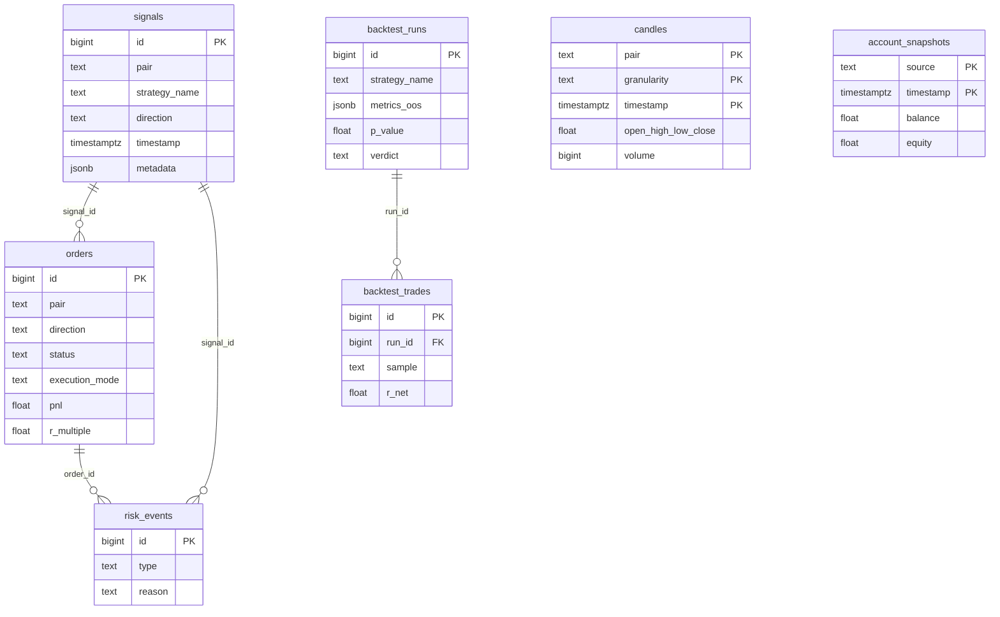

# Base de datos

PostgreSQL 13+ (probado en 16.4). TimescaleDB es **opcional**: si el servidor la tiene, `candles` y `account_snapshots` se vuelven hypertables; si no, son tablas normales y el sistema funciona igual.

- Esquema completo: [infra/postgres/init.sql](../infra/postgres/init.sql) (versión 2, idempotente).
- Aplicarlo a cualquier BD: `python scripts/init_db.py`. Para ver el estado sin cambiar nada: `--verificar`.

## Cómo crear o actualizar la base

| Dónde está la BD | Qué hacer |
|---|---|
| Docker local (`docker-compose-dev.yml`) | Nada: `init.sql` se ejecuta solo al crear el volumen. Si el volumen ya existía, `python scripts/init_db.py`. |
| Dokploy / servidor | Crear la BD vacía (ya está hecha). Con `POSTGRES_*` en las variables de la app, abrir la terminal del contenedor y ejecutar `python /app/scripts/init_db.py`. |
| Otra PC con Postgres | Completar `POSTGRES_*` en `.env` y ejecutar `python scripts/init_db.py`. |
| BD con el esquema v1 | `python scripts/init_db.py`: agrega lo nuevo sin perder datos. Si además venía de la versión OANDA antigua, antes correr `migrations/001_xm_mt5.sql`. |

El script trabaja en **una sola transacción**: si algo falla, la BD queda como estaba.

## Diagrama

## Tablas

| Tabla | Quién escribe | Para qué | Estado |
|---|---|---|---|
| `candles` | data-collector | Velas OHLC cerradas. PK `(pair, granularity, timestamp)` | En uso |
| `signals` | strategy-engine | Cada señal de cada estrategia | En uso |
| `orders` | risk-manager (reserva), execution-engine | Órdenes y posiciones, de `pending` a `closed` | En uso |
| `schema_version` | `init.sql` | Versión del esquema aplicada | En uso |
| `account_snapshots` | execution-engine (pendiente) | Historial de balance y equity, para la curva de capital real | Preparada |
| `risk_events` | monitoring (pendiente) | Rechazos y alertas, para saber por qué no se operó | Preparada |
| `backtest_runs` | backtester (fase 2) | Cada validación: periodo, parámetros, métricas IS/OOS, p-valor, IC, veredicto, commit | Preparada |
| `backtest_trades` | backtester (fase 2) | Operaciones de cada validación, en R | Preparada |

## Vistas

Separan siempre por `execution_mode`, porque mezclar simulación (`sim`) con cuenta MT5 (`mt5`) engaña. Los días son días UTC.

| Vista | Muestra |
|---|---|
| `v_strategy_performance` | Por estrategia: operaciones, acierto, PnL, R promedio, profit factor |
| `v_pair_performance` | Lo mismo por par |
| `v_daily_pnl` | PnL y R por día |
| `v_equity_curve` | PnL y R acumulados, operación por operación |
| `v_open_positions` | Posiciones abiertas y desde hace cuántos minutos |
| `v_signal_funnel` | Por día: señales → órdenes reservadas → ejecutadas → cerradas |
| `v_backtest_summary` | Últimas validaciones con sus métricas fuera de muestra y el veredicto |

## Protecciones que pone la BD

- **Un trade activo por par** (`ux_orders_un_activo_por_par`): segunda barrera además de la regla del risk-manager. Si dos señales del mismo par llegan a la vez, la BD rechaza la segunda reserva y el risk-manager la descarta.
- **CHECK** de valores válidos en `status`, `direction`, granularidad, `confidence` y precios de velas (`low > 0`, `low <= high`).
- **`updated_at` automático** (trigger) en `orders`.
- **`r_multiple`** calculado (`pnl / risk_amount`): el resultado de cada orden en R, la misma unidad que usa la validación del backtest.
- **Zona horaria UTC** como valor por defecto de la base.

## Reglas para cambiar el esquema

1. Editar `init.sql` manteniéndolo idempotente (`IF NOT EXISTS`, `pg_temp.agregar_restriccion`, `DROP VIEW` + `CREATE VIEW`), subir la versión en `schema_version` y probarlo dos veces seguidas sobre una BD vacía y sobre una con datos.
2. Precios y montos en `DOUBLE PRECISION`, nunca `NUMERIC`: psycopg2 devolvería `Decimal` y rompería la aritmética del simulador y de la reconciliación.
3. Nunca poner restricciones que puedan fallar al marcar una orden `filled` o `closed` (`exit_reason`, `units`, `execution_mode`, ticket). Si fallan, queda una posición real abierta sin registrar en la BD. Solo se permiten restricciones que fallen al **reservar**, que es seguro (la orden se rechaza).
4. Sin compresión de TimescaleDB en `candles`: el data-collector hace upsert de velas recientes, y en chunks comprimidos eso puede fallar.
